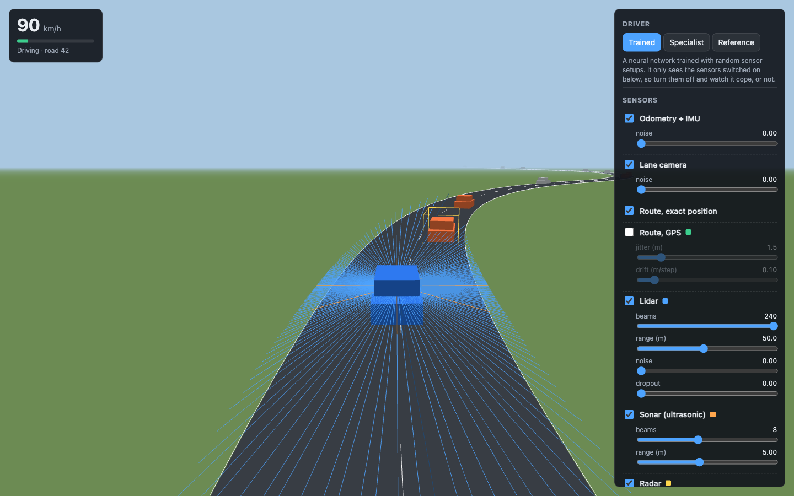
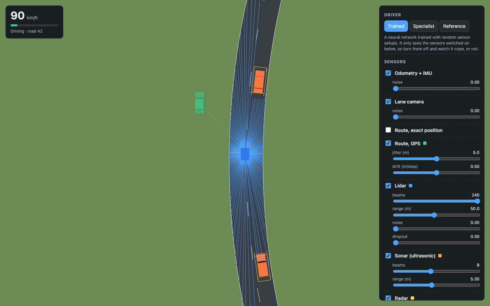
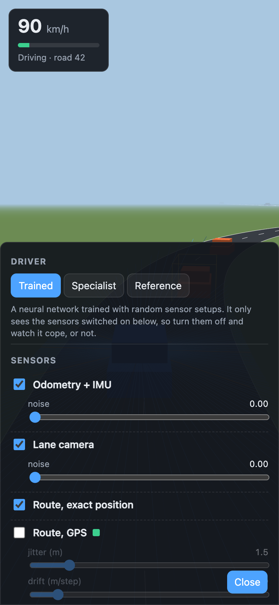

# self-driving-optimized

How little does a self-driving car actually need to sense?

**[Try it in your browser →](https://siroxou.github.io/self-driving-optimized/web/)** Switch sensors off, change their settings, and watch the car cope. Nothing to install.

This project trains a car to drive in simulation and then takes its senses away (lidar, ultrasonic, radar, GPS, lane camera, odometry) to see where it starts to fail.

It has two parts:

- **Browser playground** ([live](https://siroxou.github.io/self-driving-optimized/web/)): switch sensors off, drag sliders for beam count, range and noise, and watch the car cope or crash in 3D. It runs entirely in your browser. The plan is in [ROADMAP.md](ROADMAP.md) and the design is in [docs/web.md](docs/web.md).
- **Research track** (`research/`): a sensor ablation study on the [MetaDrive](https://github.com/metadriverse/metadrive) simulator using PPO. It's higher fidelity and slower, and it's used to check the playground's findings.

## Sensors

Both parts use the same sensors:

| Name | Real-world equivalent | What the car gets |
|---|---|---|
| `odom` | Wheel encoders + IMU | speed, steering angle, last throttle/steer, yaw rate |
| `lane` | Lane-keeping camera | distance to each road edge, heading error to the lane |
| `nav` | HD map + exact localisation | offsets to the next two route checkpoints, lane curvature |
| `gps` | Consumer GNSS + map | same as `nav`, with jitter and a slowly drifting bias |
| `lidar` | 360° 2D lidar | distance per beam, 240 beams, 50 m |
| `sonar` | Ultrasonic parking sensors | distance per beam, 8 beams, 5 m |
| `radar` | Automotive radar | position and velocity of the 4 nearest vehicles, 80 m |

How each one is modelled, and what it gets wrong compared with real hardware, is in [docs/sensors.md](docs/sensors.md).

## 3D viewer



| Top-down, with noisy GPS | Phone |
|---|---|
|  |  |

The simulator runs in the browser through Pyodide and is drawn in 3D with three.js. It's live at **https://siroxou.github.io/self-driving-optimized/web/**. To run it locally instead, from the repo root:

```bash
python -m http.server 8000
```

Open http://localhost:8000/web/. The first load downloads about 10 MB of Python (cached afterwards). You can:

- turn each sensor on or off and change its settings while the car drives
- see what each sensor reports: lidar rays (blue), sonar rays (orange), radar tracks (yellow boxes), and a green "ghost" car where GPS thinks you are
- change lanes, bendiness, traffic and parked cars, or jump to any road number
- switch between chase, top-down and free cameras, and run at 1×, 2× or 4×

Pick who drives:

| Driver | What it is |
|---|---|
| **Auto** (default) | the specialist network trained on exactly the sensors you have switched on. If there isn't one for that combination, the generalist drives instead. One-click presets load each sensor set that has a specialist |
| **Generalist** | one network trained with random sensor setups. It copes with any combination, some much better than others |
| **Reference** | a hand-written lane follower that reads the simulator directly. It ignores the sensors; useful to see what "perfect" looks like |

Every network sees only the sensors you switch on, so turning them off really changes how the car drives.

How the networks are trained and how well they score is in [docs/training.md](docs/training.md).

## Browser simulator quickstart

The simulator in `sim/` is pure Python + numpy. The browser front end comes in Phase 3, but the sim already runs locally:

```bash
python -m venv .venv && source .venv/bin/activate
pip install -r requirements.txt
pytest tests                 # simulator tests
python -m sim.env            # speed check + reference lane-follower run
```

```python
from sim.env import DriveEnv

env = DriveEnv(sensors={"lidar": {"beams": 16}, "gps": {"on": True}, "nav": {"on": False}},
               scenario={"traffic": 0.2})
obs, info = env.reset(seed=0)
obs, reward, terminated, truncated, info = env.step([0.0, 0.5])  # [steering, pedal]
env.configure(sensors={"lidar": {"on": False}})                    # takes effect next step
```

Every sensor setting and its allowed range is listed in [docs/sensors.md](docs/sensors.md#browser-sim-differences).

## Research track quickstart

Tested on Python 3.11.

```bash
cd research
python -m venv .venv && source .venv/bin/activate
pip install -r requirements.txt
pytest
```

The first run downloads MetaDrive's map and vehicle assets.

```bash
python train.py --sensors odom,lidar,nav --steps 300000      # train one sensor set
python evaluate.py runs/odom+nav+lidar-s0 --episodes 50        # score it on unseen maps
python evaluate.py runs/odom+nav+lidar-s0 --episodes 3 --render  # watch it drive
python ablate.py                                               # the full study
```

The method, metrics and expected running times are in [research/experiment.md](research/experiment.md).

## Results

Success rate on 50 unseen roads, for the model the viewer's Auto driver uses on each sensor set (full tables and discussion in [docs/training.md](docs/training.md#results)):

| Sensors | Success | Model |
|---|---|---|
| Odometry + Camera + Route + Lidar (default) | 92% | generalist |
| Odometry + Route + Lidar | 90% | specialist |
| Odometry + GPS + Lidar | 86% | generalist |
| everything on | 78% | specialist |
| Odometry + Camera + Route + Radar | 66% | specialist |
| Odometry + Route + Sonar + Radar | 60% | specialist |
| Lidar only | 50% | specialist |
| Odometry + Camera + Route | 0% | nothing in this set detects other cars |

So far: lidar is the strongest single sensor on these roads, but not essential. With a network trained for them, camera + radar and sonar + radar both drive. What the car can't do without is something that detects other cars. [ROADMAP.md](ROADMAP.md) lists what's next. The MetaDrive research track hasn't had its full run yet.

## Layout

```
sim/                 browser simulator: roads, car, traffic, sensors, gym env, numpy policy runner
train/               PPO training, export to numpy, benchmark
web/                 3D viewer: three.js scene, controls, Pyodide worker, trained models
results/             benchmark tables
tests/               simulator tests
research/            MetaDrive study: sensors, training, evaluation, ablation
docs/sensors.md      sensor definitions shared by both parts
docs/web.md          browser playground architecture
docs/training.md     how the driving networks are trained and scored
ROADMAP.md           phases and exit criteria
```

## License

MIT
